# DiceWallet

<table>
  <tr>
    <td>
        <a href="assets/readme_images/ui_main_menu.jpg">
        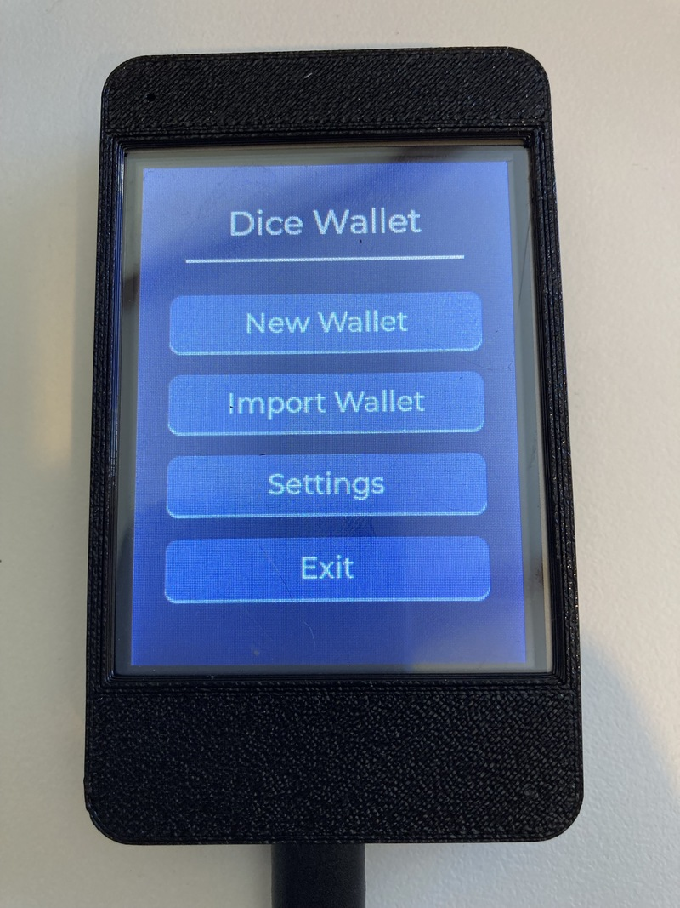
        </a>     
    </td>
    <td>
        <a href="assets/readme_images/ui_new_wallet_seed_instructions.jpg">
        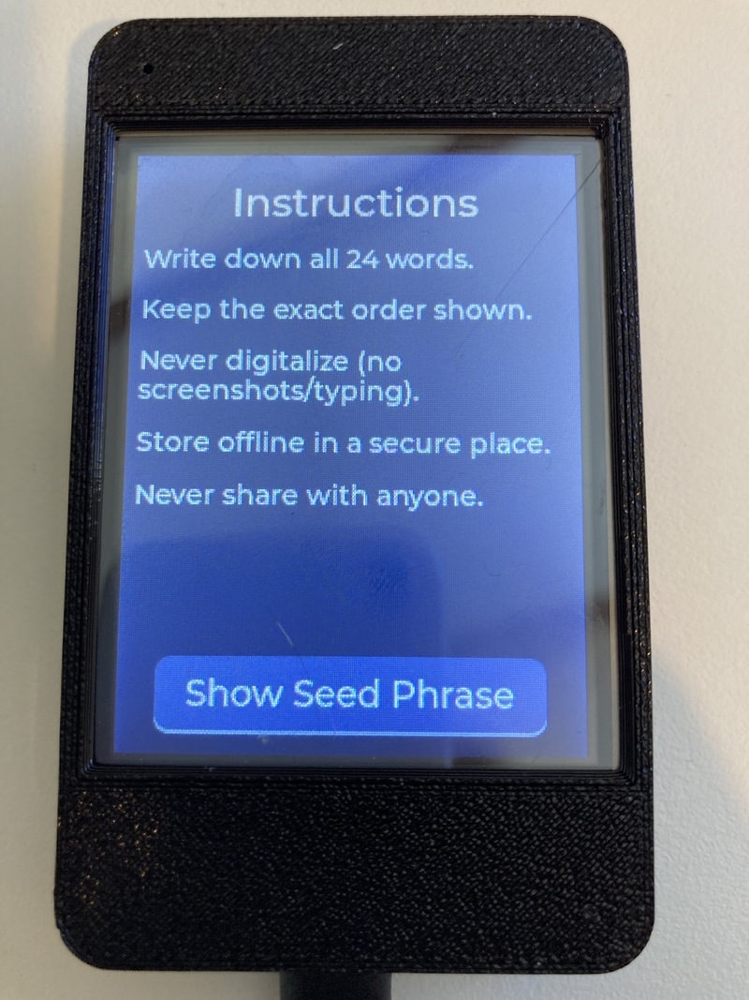
        </a>    
    </td>      
    <td>
        <a href="assets/readme_images/ui_new_wallet_dice_roll.jpg">
        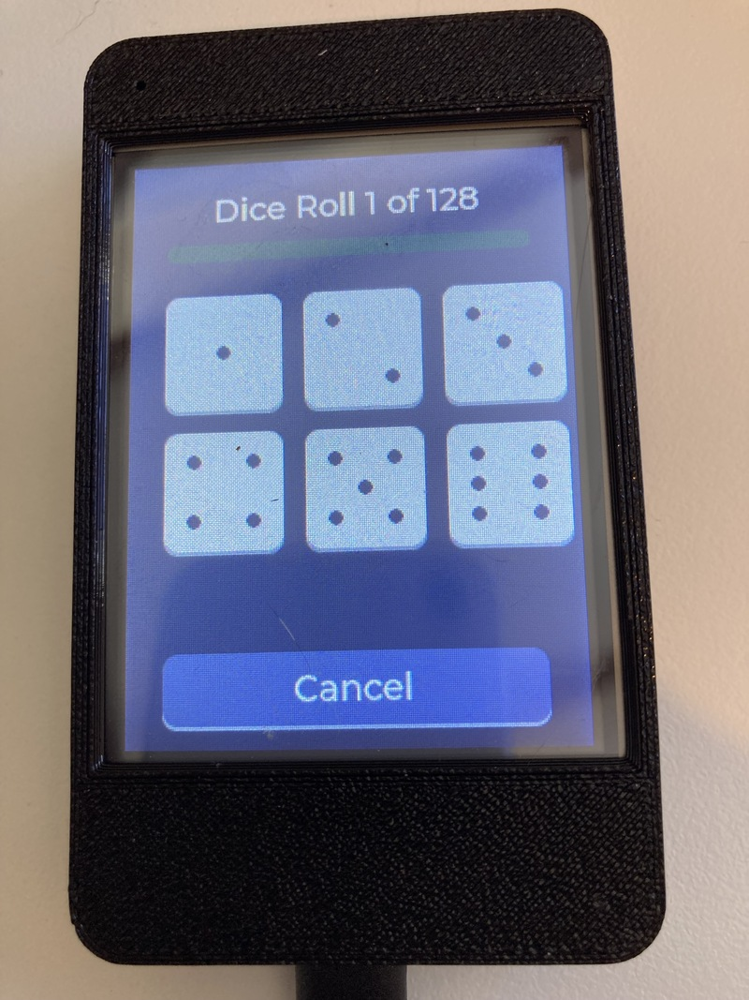
        </a>    
    </td>
    <td>
        <a href="assets/readme_images/ui_new_wallet_verify_seed.jpg">
        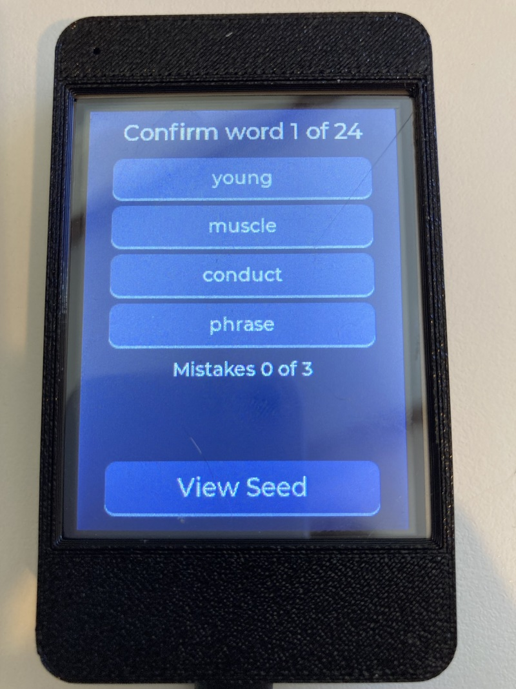
        </a>    
    </td>
    <td>
        <a href="assets/readme_images/ui_wallet_display_seed_words.jpg">
        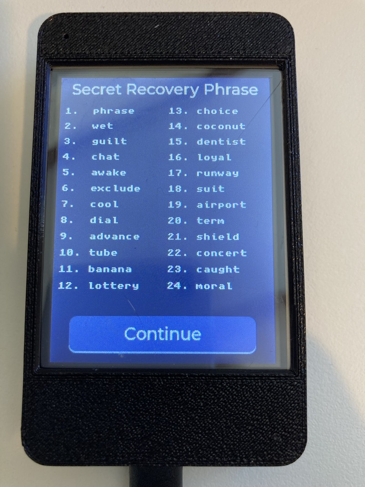
        </a>    
    </td>      
    <td>
        <a href="assets/readme_images/ui_wallet_view_public_key_btc.jpg">
        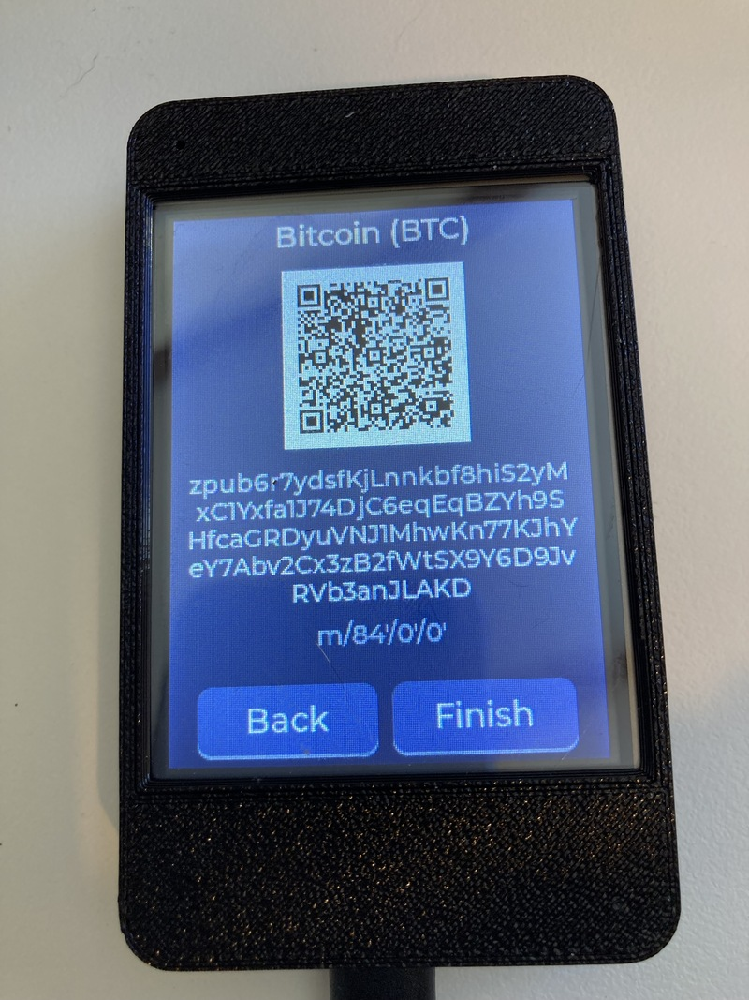
        </a>    
    </td>         
  </tr>
  <tr>
    <td align="center">Main menu</td>
    <td align="center">Instructions</td>
    <td align="center">Dice roll</td>
    <td align="center">Confirm words</td>
    <td align="center">Recover phrase</td>
    <td align="center">View public key</td>    
  </tr>
</table>

**DiceWallet** is experimental open-source wallet firmware for ESP32-2432S028 CYD (Cheap Yellow Display) boards. These boards are relatively inexpensive and easy to source. DiceWallet is amnesic and works completely offline. 

When creating a new wallet it turns 100 to 200 physical six-sided dice rolls into a BIP39 seed phrase, then shows watch-only extended public keys (xpubs) as QR codes. 

The design prioritizes **verifiable entropy** and a short secret lifetime. This build compiles out Wi-Fi and Bluetooth and disables serial at boot. Secrets are held in RAM for the session and wiped on exit. The device does not store a seed in flash. Only xpubs are shown on screen, so another wallet (e.g. phone app) can import a watch-only wallet to view receive-only addresses.

To spend you would need to import the 24 word BIP39 mnemonic seed phrase into another wallet. This wallet does not reveal private keys, nor does it sign transactions.

Version: **0.1.0** (experimental; not a 1.0 release)

---

## Why Dice?

Most hardware wallets rely on a hardware random number generator (TRNG). While modern TRNGs are excellent, they are opaque. Users must trust that the chip is not biased, that the firmware is not leaking entropy, that the software isn't actually using a PRNG (Pseudo Random Number Generator), and that the manufacturer did not insert a backdoor.

DiceWallet takes a different approach:

1. The user rolls a physical die **100 to 200 times**. Advanced settings choose the count; the default is 128.
2. The device records each face (1–6).
3. A suite of statistical tests indicate whether the sequence looks like fair dice rolls.
4. The entered rolls are hashed with a domain separator into exactly 256 bits of BIP39 entropy. One hundred fair rolls are about 258.5 bits; 200 are about 516.9 bits.
5. A 24-word BIP39 mnemonic is generated.

The user can see every roll on screen, can re-roll if the tests fail, and can independently verify the mapping from rolls → entropy → mnemonic if they wish.

### Why 128 rolls is the default

A fair six-sided die has log2(6) ≈ 2.585 bits of entropy per roll. A 24-word BIP39 seed needs 256 bits. That is about 99 fair rolls. One hundred fair rolls are about 258.5 bits, which is just over the minimum. Two hundred are about 516.9 bits.

The default is 128, about 330.9 bits, because a real die is not a perfect fair source.

Casino-grade dice are precision made: sharp edges, balanced pips, and tight tolerances. A standard consumer die is not. Drilled or painted pips, air bubbles, rounded edges, and uneven faces all bias the result. The bias is usually small, and the fairness battery can miss a small bias at these sample sizes. Chi-square is a warning aid, not a proof that the die was fair.

128 rolls is the margin for that. A modestly imperfect consumer die can lose some entropy on every roll and still leave well more than 256 bits in the sequence. The domain-separated SHA-256 then compresses whatever was collected into exactly 256 bits of BIP39 entropy. Extra rolls do not make the seed longer than 256 bits. They make it more likely that a cheap die still supplied enough randomness before that compression.

One hundred remains available for a die the user trusts. Two hundred is there for a die the user does not. 128 is the default because it is the middle setting, and because it does not assume a casino die.

---

## Core Features

### New Wallet (Dice Entropy)

- Live visual die faces while entering rolls.
- Real-time progress toward the configured roll count (100–200).
- **Statistical fairness battery** (see [Fairness Testing](#fairness-testing) below).
- Three possible outcomes:
  - **Success** — all tests passed.
  - **Warning** — Chi-square (frequency) passed, but one or more secondary tests failed.
  - **Error** — Chi-square failed (die is biased or the sequence is not random).
- 24-word BIP39 mnemonic display (with optional BIP39 passphrase).
- Seed verification step (user re-enters selected words).

### Import Wallet

<table>
  <tr>
    <td>
        <a href="assets/readme_images/ui_import_wallet_words.jpg">
        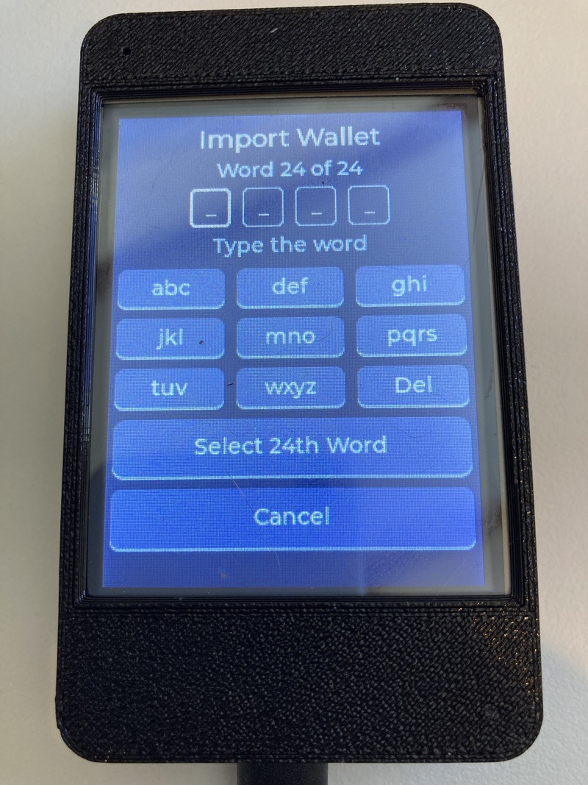
        </a>     
    </td>
    <td>
        <a href="assets/readme_images/ui_import_wallet_words_select.jpg">
        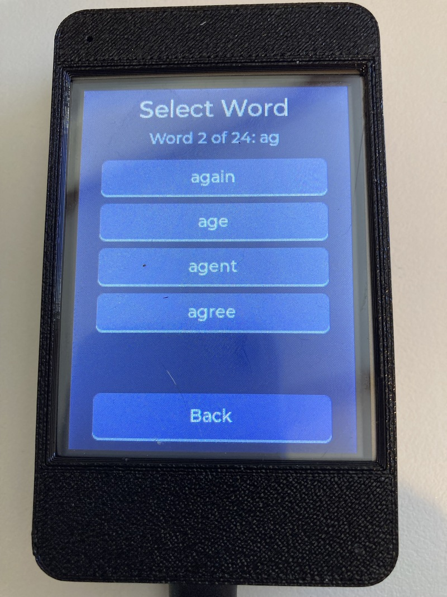
        </a>    
    </td>      
    <td>
        <a href="assets/readme_images/ui_import_wallet_words_select_24th_button.jpg">
        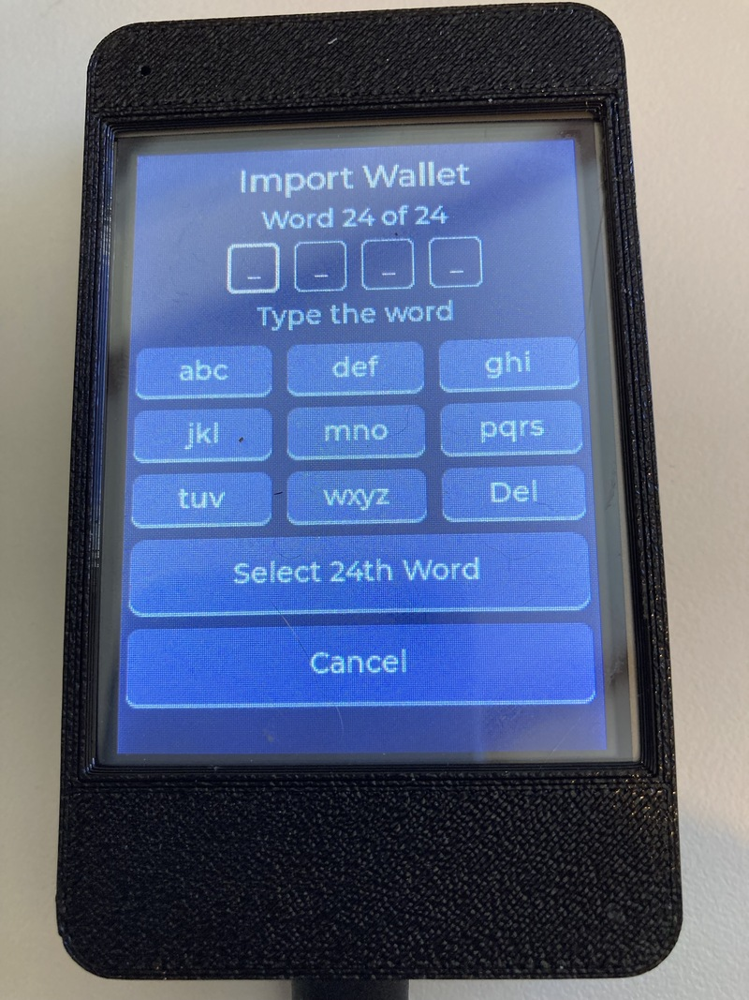
        </a>    
    </td>        
  </tr>
  <tr>
    <td align="center">Import words</td>
    <td align="center">Select word</td>
    <td align="center">Select 24th word</td> 
  </tr>
</table>

Multiple input methods are supported so users can restore from any existing BIP39 seed:

| Method              | Description                                      |
|---------------------|--------------------------------------------------|
| Word entry          | Type letters; cycling suggestions from the wordlist |
| Word index          | Enter the 0-based index of each word (0–2047)    |
| Hex                 | Enter 0-based word indexes as hex (0x0-0x7FF)                 |
| Binary              | Enter 11-bit word indexes as binary (0000000000-11111111111)                    |

All methods validate the BIP39 checksum before accepting the seed.

### Selecting the 24th word

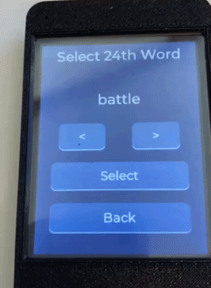

When importing a wallet using English words you have the option to select the 24th word. This feature could be useful if you have your own method of randomly selecting the first 23 words and you want a completely offline way to calcuate and select a valid 24th word.

A 24-word BIP39 mnemonic is 264 bits: 256 bits of entropy plus an 8-bit checksum. Each word is 11 bits. The first 23 words are 253 bits, so the last word carries the remaining 3 entropy bits and the 8-bit checksum.

After the first 23 words are entered, `bip39_valid_final_words()` tries all 8 possible values of those 3 bits. For each value it builds the 256-bit entropy, takes SHA-256, and uses the first hash byte as the checksum. The 24th-word index is those 3 bits followed by that checksum byte. The screen looks those 8 indexes up in the English wordlist.

The Select 24th Word screen shows one of those 8 words. `<` and `>` cycle through them. Select accepts the shown word. Any of the 8 produces a mnemonic with a valid checksum, but only the word from the original backup is the user's seed. The other 7 are different wallets.

### View the BIP39 seed phrase

<table>
  <tr>
    <td>
        <a href="assets/readme_images/ui_wallet_display_seed_words.jpg">
        
        </a>     
    </td>
    <td>
        <a href="assets/readme_images/ui_wallet_display_seed_int_indexes.jpg">
        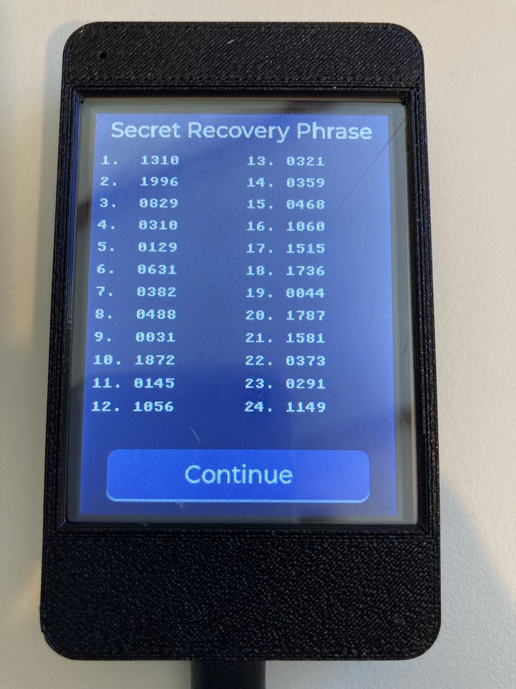
        </a>    
    </td>      
    <td>
        <a href="assets/readme_images/ui_wallet_display_seed_binary.jpg">
        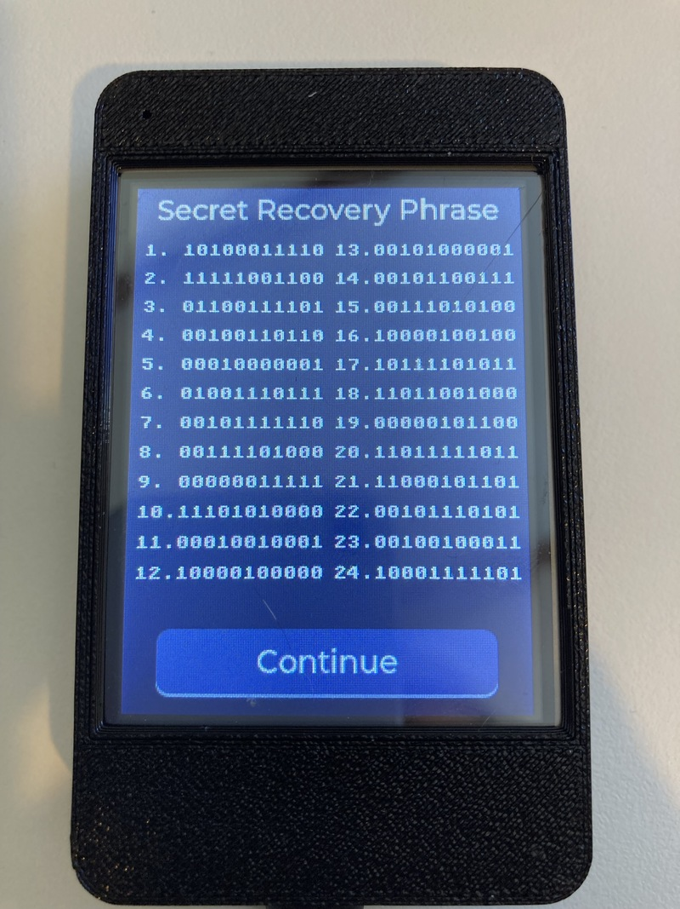
        </a>    
    </td>        
    <td>
        <a href="assets/readme_images/ui_wallet_display_seed_dots.jpg">
        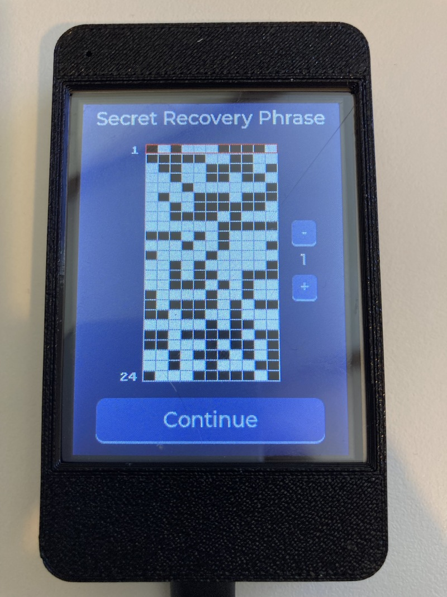
        </a>    
    </td>     
  </tr>
  <tr>
    <td align="center">View words</td>
    <td align="center">Integer word indexes</td>
    <td align="center">Binary word indexes</td> 
     <td align="center">Dot map view</td> 
  </tr>
</table>


The view seed screen always opens on the 24 words, numbered 1 to 24. With **Wallet mode: Advanced** enabled in Settings, tapping the word list cycles through five views of the same mnemonic. In Simple mode the tap does nothing.

Each BIP39 word is an 11-bit index into the 2048-word English list, from 0 to 2047. The extra views show that index instead of the word.

| View | What it shows | Example for word 1, index 0 |
|------|----------------|------------------------------|
| Words | The English word | `1. abandon` |
| Integer | The index, 0–2047, four digits | `1. 0000` |
| Hex | The index as three hex digits | `1. 000` |
| Binary | The index as 11 bits, high bit first | `1. 00000000000` |
| Dot grid | The same 11 bits as a punch plate | one row of the grid |

The integer, hex, and binary lines are the same value. `0000`, `000`, and `00000000000` are all index 0. Index 2047 is `2047`, `7FF`, and `11111111111`.

The dot grid is a 24 by 11 plate. Each row is one word. Each column is one bit of that word's 11-bit index, with the high bit on the left. A filled cell is a 1. An empty cell is a 0. Up and down move a red highlight between rows, and the highlighted row number is shown beside the plate. The grid is the binary view drawn for a punch card or a transcription plate, not a different encoding.

All five views are the same 24 indexes. Changing the view does not change the seed.

### View Public Keys (Watch-Only)

After a seed is loaded (generated or imported), the device can derive and display, as a QR code, account-level extended public keys:

| Coin       | Path              | Serialization | Notes                  |
|------------|-------------------|---------------|------------------------|
| Bitcoin    | `m/84'/0'/0'`     | zpub          | Native SegWit (BIP84)  |
| Ethereum   | `m/44'/60'/0'`    | xpub          | BIP44                  |
| XRP        | `m/44'/144'/0'`   | xpub          | BIP44                  |

An optional BIP39 passphrase is supported and is wiped from memory after use.

### Settings

- **Screen** — Brightness and auto-blank timeout (saved to NVS).
- **Language** — Extensive localization (see [Languages](#languages)).
- **Advanced**
  - Die-roll count, from 100 to 200 (default 128, saved to NVS).
  - Auto-wipe timer (device wipes secrets after a configurable number of minutes of inactivity).
  - Manual secure wipe.
  - Exit / secure shutdown screen.
- **About** — Firmware version and the SHA-256 of the running app image. Compare this hex to the published `firmware.sha256`.
- **Predelivery** — Factory / eFuse-related checks (UART download disable, etc.).

### Security Hardening

- Wi-Fi and Bluetooth are compiled out (`CONFIG_BT_ENABLED=n`, `CONFIG_ESP_WIFI_ENABLED=n`).
- Serial is disabled at boot.
- Secrets (rolls, mnemonic word pointers/indexes, passphrase, import buffers) are wiped with volatile stores that the compiler cannot optimize away.
- On every screen transition, all label and textarea text in RAM is securely wiped before the old screen is deleted.
- Additional scrubbing of free heap blocks, abandoned stack frames, the framebuffer, and the display GRAM.
- Optional automatic wipe after inactivity.
- Firmware can check whether UART download mode has been permanently disabled via eFuse.

---

## Fairness Testing

Before a new wallet is accepted, the entered sequence (100–200 rolls, depending on the setting) is subjected to the following tests (implemented in `src/dice/die_fairness.cpp`):

| Test                  | Purpose                                      | Failure Mode                  |
|-----------------------|----------------------------------------------|-------------------------------|
| **Chi-square**        | Face frequency uniformity                    | Biased die or non-random sequence |
| **Runs test**         | Too few / too many runs of high/low faces    | Human-faked patterns          |
| **Serial correlation**| Dependence between consecutive rolls         | Pattern bias                  |
| **Gap test**          | Distribution of gaps between specific faces  | Over-uniformity               |
| **Longest run**       | Extremely long runs of the same face or high/low | Suspicious streaks         |
| **Poker test**        | Frequency of 5-roll “hands”                  | Non-random grouping           |
| **Autocorrelation**   | Correlation at various lags                  | Hidden dependence             |

**Verdict logic**:
- Chi-square fails → **Error** (user must start over).
- Chi-square passes but any other test fails → **Warning** (user may continue or re-roll).
- All tests pass → **Success**.

This gives the user transparent, quantitative feedback about the quality of their entropy source.

---

## Entropy Pipeline

```
100–200 physical d6 rolls (faces 1–6, count from Advanced settings)
        │
        ▼
Domain-separated SHA-256
  (prefix: 'D','6',0x01, length=count + raw faces)
        │
        ▼
Exactly 256 bits of BIP39 entropy
        │
        ▼
BIP39 checksum (SHA-256 of entropy → first 8 bits)
        │
        ▼
24-word mnemonic (English wordlist by default)
```

The hashing step eliminates the bias that a naive base-6 → 256-bit modular reduction would introduce.

---

## Languages

The UI is fully translated. Supported languages include:

- English
- French, German, Polish, Swedish, Dutch, Italian, Spanish, Portuguese
- Russian (Cyrillic font)
- Chinese (Simplified), Japanese, Korean (custom CJK fonts)

Font assets are embedded as C arrays (`custom_*.c`) for the required character sets.

---

## Hardware

Target platform: **ESP32-CYD** (Cheap Yellow Display) boards running the Arduino framework via PlatformIO.  
These boards are inexpensive, widely available, and include a color touchscreen with enough resources to run DiceWallet comfortably.

### Where to buy

Buy a generic **ESP32-2432S028** (CYD) board. Search for `ESP32-2432S028` or `ESP32 Cheap Yellow Display`. Confirm the listing is the 2.8 inch 240×320 resistive-touch board. Some panels are ST7789. This build expects ILI9341 but could be easily modified for other displays.

DiceWallet is not affiliated with any of the sellers or links below.

- [AliExpress — ESP32-2432S028](https://www.aliexpress.com/item/1005011857768315.html)
- [Amazon — ESP32-2432S028](https://www.amazon.com/AOICRIE-Development-ESP32-2432S028R-Bluetooth-Resistive/dp/B0FFGZTGYN/ref=sr_1_6?th=1)

> **Privacy note:** Ordering a generic ESP32 development board does not create a customer record tied to crypto wallet firmware.

### Display & Touch

- **Display**: ILI9341 (`ILI9341_2_DRIVER`), 240×320, SPI. Some CYD boards are ST7789; this build does not enable `ST7789_DRIVER`.
- **Touch**: XPT2046 on its own SPI bus, chip select GPIO 33
- **Backlight**: PWM on GPIO 21

### Pinout (from `platformio.ini`)

| Signal     | GPIO |
|------------|------|
| TFT_MISO   | 12   |
| TFT_MOSI   | 13   |
| TFT_SCLK   | 14   |
| TFT_CS     | 15   |
| TFT_DC     | 2    |
| TFT_RST    | -1 (tied high) |
| TFT_BL     | 21   |
| TOUCH_CS   | 33   |

The project uses **TFT_eSPI** (Bodmer) + **LVGL 9**.

---

## Building & Flashing

### Development environment

Development uses VS Code and the PlatformIO extension. The CLI commands below work in the PlatformIO terminal that the extension opens.

1. Install [VS Code](https://code.visualstudio.com/).
2. Install the PlatformIO IDE extension from the Extensions view. The extension installs the PlatformIO core and the toolchains it needs.
3. Open the DiceWallet folder with File → Open Folder. PlatformIO reads `platformio.ini` from that folder. Do not open a parent directory.
4. The first build downloads the Espressif 32 platform and the libraries. That takes several minutes. Later builds are incremental.

The board used for development and testing is an ESP32-2432S028 CYD (Cheap Yellow Display). The PlatformIO board id is `esp32dev`. Other ESP32 boards need pin and driver changes. This build selects `ILI9341_2_DRIVER`. Some CYD panels are ST7789 and will not work with this configuration.

Connect the board with a data USB cable. On first plug-in the host may need a CP210x or CH340 driver, depending on the board's USB-UART chip. Select the serial port from the PlatformIO device list if upload cannot find it.

PlatformIO installs the libraries in `lib_deps`. They are not vendored in this repository:

| Library | Use |
|---------|-----|
| `bodmer/TFT_eSPI` ^2.5.43 | Display |
| `PaulStoffregen/XPT2046_Touchscreen` v1.4 | Touch |
| `lvgl/lvgl` ^9.6.0 | UI |
| `throwtheswitch/Unity` ^2.6.1 | On-device tests |

Build with the PlatformIO checkmark, or from the PlatformIO terminal:

### Build

```bash
pio run
```

### Upload

```bash
pio run -t upload
```

### Unit Tests

Official BIP39, BIP32, and SLIP-0132 vectors run on the device with Unity, using the default `esp32dev` environment. There is no separate test environment. `pio test` defines `UNIT_TEST`, so `main.cpp` does not supply `setup()` or `loop()`.

```bash
pio test
```

Vector files and their sources are in `test/test_vectors/`.

---

## Project Structure

```
.
├── platformio.ini          # Build configuration, pin defines, library deps
├── include/
│   ├── app/                # Wallet state, secure memory, version
│   ├── dice/               # Die fairness test declarations
│   ├── drivers/            # Display / hardware init
│   ├── ui/                 # LVGL screens, theme, text, assets
│   └── lv_conf.h           # LVGL configuration
└── src/
    ├── main.cpp            # setup() / loop(), LVGL timer, screen poll
    ├── app/                # Wallet rolls + generation state, secure wipe
    ├── bip39/              # Entropy → mnemonic, wordlist, checksum
    ├── coins/              # HD derivation (BIP32/secp256k1), coin registry
    ├── third_party/        # Vendored RIPEMD-160 (not in the Arduino Mbed TLS build)
    ├── dice/               # Statistical fairness tests
    ├── drivers/            # TFT + LVGL driver init, framebuffer wipe
    └── ui/
        ├── screens/        # One file per screen (new wallet, import, settings…)
        ├── text/           # Translation tables + custom fonts
        ├── theme/          # Color palette, layout constants
        └── assets/         # Icons (secure wipe, etc.)
```

### Key Modules

| Module                  | Responsibility                                      |
|-------------------------|-----------------------------------------------------|
| `bip39_generator`       | Dice rolls → 256-bit entropy → 24-word mnemonic     |
| `die_fairness`           | Battery of statistical tests on roll sequences      |
| `hd_coins`              | BIP32 derivation of account xpubs for BTC/ETH/XRP   |
| `third_party/ripemd160` | RIPEMD-160 for HASH160 in account xpub derivation   |
| `wallet`                | In-memory storage of rolls and generated mnemonic   |
| `secure_mem`            | Volatile wipes, heap/stack scrubbing                |
| `ui_*` screens          | All user-facing flows (LVGL)                        |
| `ui_text`               | Runtime language switching                          |


### Vendored RIPEMD-160

`derive_account_xpub()` needs HASH160, which is RIPEMD-160 of a SHA-256 digest. The Arduino-ESP32 Mbed TLS library is not built with `MBEDTLS_RIPEMD160_C`, so `mbedtls_ripemd160()` is not in the prebuilt library. `src/third_party/ripemd160.c` supplies that function.

The original file is:

https://github.com/Mbed-TLS/mbedtls/blob/mbedtls-3.6/library/ripemd160.c

Two lines were changed so the implementation is compiled into this firmware: line 16 and line 494, the `#if defined(MBEDTLS_RIPEMD160_C)` guard and its matching `#endif`. Both are commented out. The rest of the file is the upstream source.

---

## Usage Flow (High Level)

1. **Splash** — Identicon from the firmware hash, and security status. The hash hex is on About.
2. **Main Menu** — New Wallet / Import Wallet / View Public Keys / Settings.
3. **New Wallet**
   - Roll the die for the configured count, 100–200 (default 128).
   - Fairness report.
   - Display 24-word seed (+ optional passphrase).
   - Verify each of the 24-word seed.
   - Optional passphrase → view seed → display xpubs.
4. **Import** — Choose method → enter data → checksum validation → optional passphrase → seed display → view public keys.
5. **Settings** — Brightness, timeout, language, auto-wipe, about, secure exit.

On every transition away from a secret screen, the device performs a multi-stage wipe of RAM, heap, stack, and display memory.

---

## Design Principles

- **No network stack in this build** — Wi-Fi and Bluetooth are compiled out, and serial is disabled at boot. The ESP32 radio silicon, ROM bootloader, and USB-UART bridge are still on the board.
- **Verifiable entropy** — The user enters physical dice rolls. Statistical tests are a warning aid, not a proof that a die was fair.
- **Minimal secret lifetime** — Secrets exist in RAM while the device is powered on and are wiped on exit. They are not written to NVS.
- **Watch-only UI** — The screen shows xpubs. 
- **Transparent UI** — Every roll is visible; fairness results are explained.
- **Localization first** — Broad language support with proper fonts.

---

## Secure Boot

Secure boot is a separate build. `pio run` stays unsigned. The secure environment signs the bootloader and the app with a key that is not in the repository.

This needs an ESP32 revision v3.0 or later. Check with `espefuse summary` before flashing a board. Secure Boot v2 is not available on older ESP32 modules.

To check the status of the ESP eFuses run this command (your port may differ):

```bash
~/.dicewallet/esptools/bin/espefuse --port /dev/ttyUSB0 summary
```

To build:

```bash
pio run -e esp32dev_secure
```

To build and upload signed bootloader, partitions, and app run the following command. After a successful upload your board will only be able to run firmware signed with your private key. Also there is a change of bricking the board.

```bash
pio run -e esp32dev_secure -t upload-signed
```


### Signing Key

The PEM lives outside the tree:

```text
~/.dicewallet/secure_boot_signing_key.pem
```

Or set the `DICEWALLET_SIGNING_KEY` env setting to its path. `scripts/sign_firmware.py` uses that key. If it is missing, the secure build prints `secure boot: key not present, image unsigned` and does not sign.

Generate it once, on a machine you keep the key on:

```bash
mkdir -p ~/.dicewallet
espsecure generate-signing-key --version 2 ~/.dicewallet/secure_boot_signing_key.pem
chmod 600 ~/.dicewallet/secure_boot_signing_key.pem
```

Losing this file bricks every board whose digest was burned from it. Keep an offline copy. Do not commit it.

### What the build writes

The signed files are under `.pio/build/esp32dev_secure/`:

```text
bootloader.signed.bin
firmware.signed.bin
dicewallet-<version>-esp32dev_secure.signed.bin
```

Signing appends a signature block. It does not change the app validation hash. The About screen still shows that hash.

### First flash

The build does not burn fuses. `pio run -e esp32dev_secure -t upload` writes the app. With secure boot enabled it does not write the bootloader. Flash the signed bootloader yourself, then the app:

```bash
~/.dicewallet/esptools/bin/esptool.py --port /dev/ttyUSB0 write_flash 0x1000 .pio/build/esp32dev_secure/bootloader.signed.bin
pio run -e esp32dev_secure -t upload
```

Reset the board and watch the serial log. On that first boot the signed bootloader writes the key digest into `BLOCK2` and burns `ABS_DONE_1`. After that, only images signed by this key will start.

### Verify

```bash
~/.dicewallet/esptools/bin/espefuse --port /dev/ttyUSB0 summary
```

Secure boot is on when `ABS_DONE_1` is True and `BLOCK2` is no longer all zeros. The splash screen reads the same fuse and shows **Secure Boot On** or **Secure Boot Off**.

Do not burn `ABS_DONE_1` by hand. Let the bootloader do it, so the digest matches the key that signed the image.

---

## Limitations & Notes

- Experimental firmware for a development board. Not a 1.0 hardware wallet.
- No secure element. This is a development board running the seed in ordinary RAM.
- eFuse locks (JTAG, UART download, Bluetooth, ROM console) are optional and irreversible.

### Device threat model

The seed is not written to flash. It exists in RAM for the session and is wiped on exit. Power-off drops it. A later dump of the flash does not contain any secret data.

Remote attack is not feasible. This build compiles out Wi-Fi and Bluetooth. An attacker needs physical access to the device itself.

#### Entropy weakness

The device does not create randomness. It records what the user enters and hashes it. The seed is only as unpredictable as the die rolls.

A fair physical die, rolled by hand, is the source this firmware is built for. The fairness battery can catch a sequence that is too even, too repetitive, or too patterned. It cannot tell a real die from a person copying numbers off a screen. A sequence that looks fair will pass.

Numbers from a website, a phone app, a spreadsheet, or another digital RNG are not dice rolls. Whoever runs that generator, or whoever watches the request, can know the sequence. The device will accept it, hash it, and produce a valid mnemonic. The checksum will pass. The wallet will look normal. The entropy came from a machine the user does not control.

Typing a pattern, reusing a sequence, or letting someone else call out the rolls is the same failure. The hash does not add randomness. It only compresses what was entered. One hundred twenty-eight copied numbers are still copied numbers.

The mitigation is the procedure, not a setting. Roll a physical die. Enter the faces yourself. Re-roll if the fairness screen warns. Do not import a sequence from a computer.

#### With secure boot

Secure Boot v2 is on, the download fuses are burned, and the user checked the About-screen hash against the published `firmware.sha256`. An unsigned image will not start. Replacing the firmware is closed, as long as the signing key stayed offline.

That leaves the powered-on window. The attacker has to have physical access and read the running device: the board is on, the session has not been wiped, and they can reach RAM or the display. Power-off ends that window. Secure boot does not hide the seed while it is on screen or in RAM.

#### Without secure boot

There is no signature check, so a different image will run. Before the seed is entered, the attacker replaces the firmware. The user then enters rolls or a mnemonic into that image. Burning the UART-download fuse closes the normal write path. It does not help if the attacker can reflash the chip another way, and it does not help if the image was already malicious when it was flashed. The About-screen hash is how the user checks the image before entering a secret.

The powered-on window is the same as with secure boot. A running device with the seed in RAM can be read. Power-off ends that window.

#### Other threats

With physical access to the device, an attacker could swap the CYD board with one containing their own malicious firmware. Secure physical access to the device and make a mark on the device that you recognize and would be difficult to repeat.

---

## License

MIT License. SPDX-License-Identifier: MIT

Copyright (c) 2026 DiceWallet contributors

Permission is granted to use, copy, modify, merge, publish, distribute, sublicense, and sell copies of this firmware. The copyright notice and license must be included in copies or substantial portions. The firmware is provided as is, without warranty. Full text: `LICENSE`.

---

## Acknowledgments

- **LVGL** — Lightweight embedded GUI library.
- **TFT_eSPI** — Fast SPI display driver.
- **mbedTLS** — Cryptographic primitives (SHA-256, ECC, PBKDF2).
- The BIP39 and BIP32 specifications.
- The statistical testing literature that inspired the fairness battery.

---

**DiceWallet** — Entropy you can hold in your hand.
